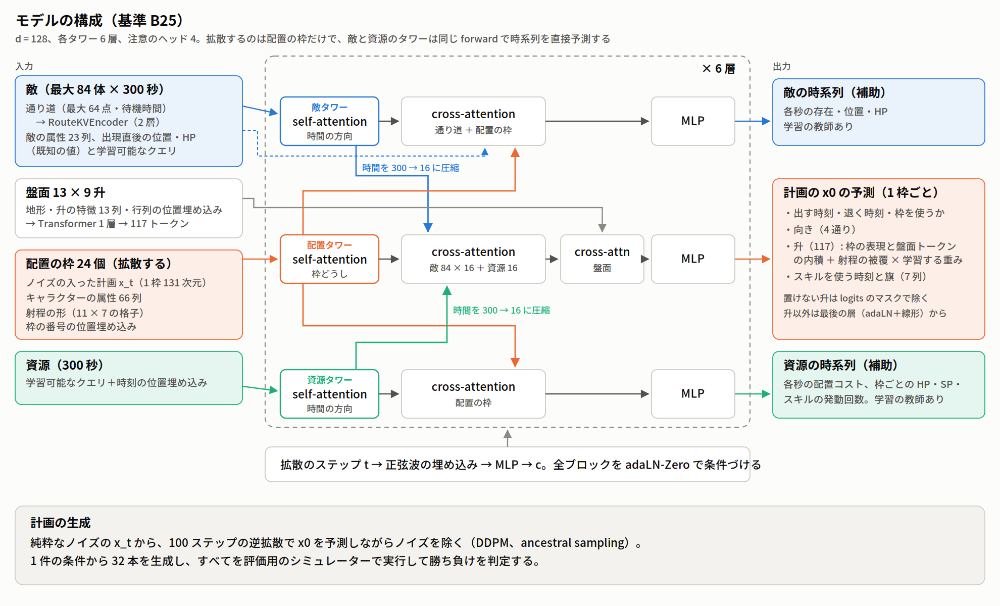
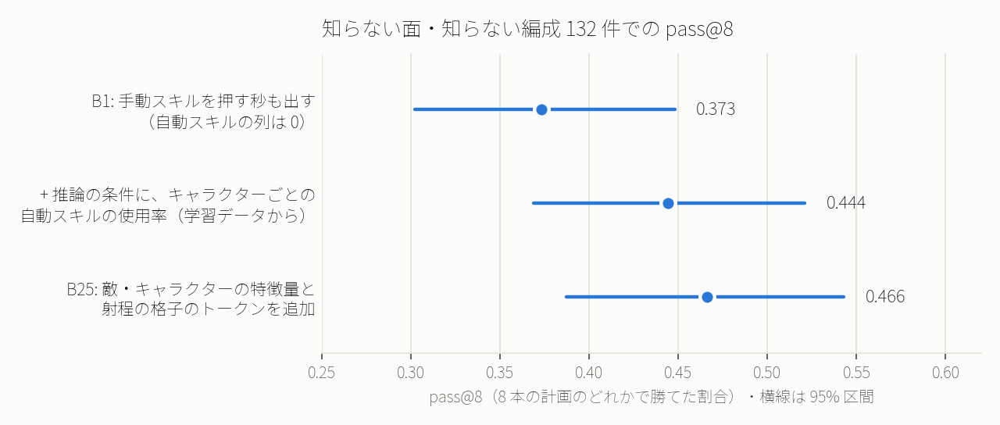
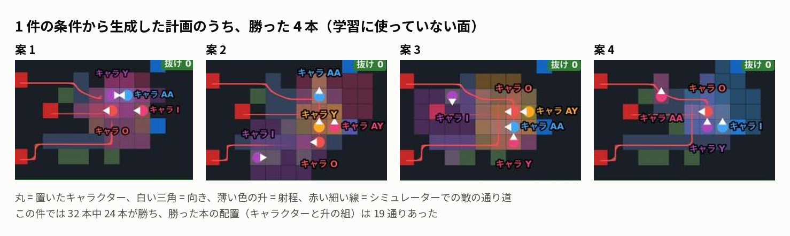
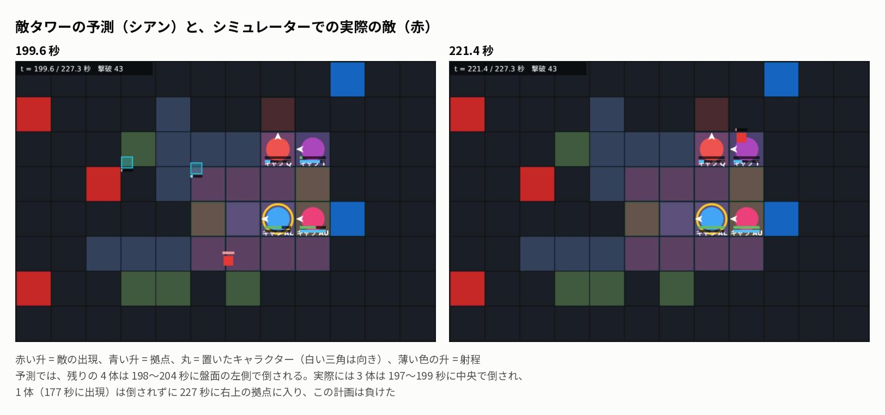

# td-plan-diffusion: 拡散モデルによる、タワーディフェンス型ゲームの攻略計画の生成

タワーディフェンス型のゲームで、面と編成を条件に、配置とスキル使用の計画を拡散モデルで複数生成する研究の記録です。学習に使っていない面・編成に対して、生成した 8 本の計画のどれかで勝てる割合（pass@8）を指標にしています。

非公式の個人研究です。評価用のシミュレーター、ゲームのデータ、データの作成方法は、権利の都合で公開していません。このリポジトリには、モデルのコード、拡散モデルの基礎の実装、実験の結果を置いています。

## 1. 問題設定

- **条件**: 面の地図（升ごとの地形）、敵の出現時刻と通り道、編成（キャラクターの能力値・射程・スキル）
- **出力**: 計画。計画の各枠は「どのキャラクターを、いつ、どの升に、どの向きで置くか」と「いつスキルを使うか」
- **勝ち**: 計画を評価用のシミュレーターで最後まで実行し、拠点のライフを減らさずに終わること
- **学習データ**: 人の攻略の記録

## 2. 手法

DiT（Diffusion Transformer）をもとにした、3 つのタワーを持つモデルです（[`world_model/`](world_model/)）。図は 4.1 の基準（B25）の構成です。

- **配置タワー**: 計画を拡散モデルで生成する。1 枠は 131 次元で、出す・退く時刻、枠を使うか、向き（4）、升（13 × 9 = 117）、スキルの使用（7）を並べたもの。x0 を直接予測する
- **敵タワー**・**資源タワー**: 敵の存在・位置・HP と、配置コスト・枠ごとの HP・SP の時系列を、学習可能なクエリから同じ forward で予測する（拡散しない）。補助の出力で、学習時は教師あり。予測の精度は 4.3
- 各層で、配置タワーは敵と資源の時系列（時間方向に 300 → 16 に線形で圧縮したもの）と盤面を cross-attention で読み、敵と資源のタワーは配置の枠を読む
- 升の logits は、枠の表現から作る query と盤面の各升のトークンから作る key の内積に、向きの予測で重み付けした射程の被覆（敵が射程内を通る延べ時間）を学習する重みで足したもの
- 拡散のステップは adaLN-Zero で全ブロックを条件づける。置けない升は logits のマスクで除く
- 生成は 100 ステップの逆拡散。1 件につき 32 本

## 3. 評価

| 組 | 内容 | 件数 |
|---|---|---|
| dev_stage | 学習に使っていない 4 面 | 67 |
| g1_eval | 学習に使った面の、学習に使っていない編成 | 65 |
| dev_stage2 | 学習に使っていない 7 面（後半の章から 1 章 1 面）。人の記録の計画をそのまま流すと 85 件すべて勝つ | 85 |

- 1 件につき 32 本の計画を生成してシミュレーターで実行し、pass@k を不偏推定で求める
- 区間は件を単位にした bootstrap の 95% 区間。2 つのモデルの差は、同じ件の対で求める
- 採否は勝ちの pass@8 だけで決める。採用の条件は、132 件（dev_stage + g1_eval）と dev_stage2 の両方で点推定が基準を上回り、差の区間の上端が 0 以上であること

## 4. 結果

### 4.1 主な結果

| 条件 | 132 件 pass@1 | 132 件 pass@8 | dev_stage2 pass@8 |
|---|---|---|---|
| B1: 手動スキルを使う時刻も出力する。自動スキルの条件の列は 0 | 0.182 | 0.373 [0.302, 0.448] | 0.127 |
| B1 + 自動スキルの条件の列に、学習データから求めたキャラクターごとの使用率を入れる | 0.233 | 0.444 [0.369, 0.521] | 0.245 |
| B25: 敵とキャラクターの特徴量を増やし、射程の形を格子のトークンにする | 0.265 | 0.466 [0.387, 0.543] | 0.258 |

- 自動スキルの列を使用率にすると、132 件で +7.0 点 [+3.6, +10.8]、dev_stage2 で +11.8 点 [+5.8, +18.5] 上がった
- B25 と B1 の差は、132 件で +2.2 点 [−2.5, +7.0]、dev_stage2 で +1.3 点 [−5.8, +8.4] で、区間が 0 をまたぐ。採用の条件は満たしたが、改善とは言えない

### 4.2 生成した計画の例

学習に使っていない面（dev_stage2）の 1 件で、B25 が生成した 32 本のうち、勝った本から配置の違う 4 本を選んで、自作の可視化のツールで表示したものです。

この件では 32 本中 24 本が勝ち、勝った本の配置（キャラクターと升の組）は 19 通りありました。同じ条件から、配置の違う勝ち方を複数生成できています。一方、どの件でもこうなるわけではなく、dev_stage2 の別の件では、32 本のうち 19 本が同じ配置になっていました。

### 4.3 敵タワーの予測は、計画の結果を反映していない

B25 の敵タワーが予測した敵の位置と、その計画をシミュレーターで実行した時の実際の敵の位置を比べました。対象は 4 組 × 5 件 × 8 本のうち、予測と実際の敵の数が一致した 123 本です。予測と実際の敵は、出現の時刻と位置の順で対応させました。

| 指標 | 値 |
|---|---|
| 同じ時刻の位置の差（升） | 中央値 1.44、90% 点 3.69。2 升を超える時刻が 34% |
| 参考: 出現した升に止まり続けると予測した場合の差 | 中央値 2.73 |
| 敵がいなくなる時刻の差 | 絶対値の中央値 3.5 秒、90% 点 12 秒 |
| 拠点に入る敵が 0 体の本の割合 | 予測 95.5%、実際 34.6% |
| 同じ件の中で、予測の抜け数が少ない本ほど勝つか（件内 AUC） | 中央値 0.50（17 件、0.42〜0.58） |

- 予測の抜け数は、予測の軌跡で、消えた時点に HP が残り、拠点の升から縦横 1 升以内にいた敵の数として数えた。同じ数え方を実際の軌跡に当てると、記録された実際の抜け数と 156 本中 123 本で一致した
- B1 の時点でも、敵タワーは 132 件の 98.8% の本で「敵を全部倒す」と予測し、件内 AUC は 0.44〜0.51 だった
- B1 で HP の補助の損失を外して学習しても、dev_stage2 の pass@8 は 0.245 で、外す前と同じだった

敵タワーは、計画によって敵の動きがどう変わるかをほとんど予測できておらず、補助のタワーとして配置の学習に効いている証拠はありません。

上は、dev_stage2 の面で負けた 1 本です。予測では最後の敵まで盤面の左側で倒されていますが、実際には 1 体が配置の下をすり抜けて拠点に入りました。

### 4.4 効果が見られなかった変更

2026-11-17〜21 に約 30 個の変更を試し、採用したのは 4.1 の 3 つです。効果が見られなかった主なものです。

| 変更 | 結果 |
|---|---|
| エキスパート反復（生成して勝った計画を学習データに足す）を 2 回 | 上がらなかった |
| スキル・素質・特性を表す 47 列を入力に足す | dev_stage2 0.182。値がキャラクターごとにほぼ固有で、識別子と同じ働きをし、学習した面との組を覚えたと見ている |
| 勝ち負けを見分ける仕組みを学習し、32 本から 8 本を選ぶ | 上がらなかった |
| 32 本から互いに遠い 8 本を選ぶ | 0.474 対 無作為 0.453（+2.1 [−1.0, +5.2]）。k-medoids では 0.417 に下がった |
| 敵を弱くした面で勝ちを作り、段階的に元の強さへ戻す | 途中の区切りで止めた |
| 離散のモード変数で 8 本を出し分ける | 途中の区切りで止めた |

## 5. 限界

- **評価の件数が少ない**: 132 件では区間が約 ±6 点あり、学習の乱数の種を変えるだけで約 3 点動く。11-20 にそれまでの 15 本の dev_stage2 の結果を並べると、上位の差は、同じ勝率で生成を引き直した時の揺れ（最大−最小の中央値 0.044）に収まっていた。差の区間が 0 を外れて上がったのは、自動スキルの列を使用率にした変更（4.1）と、B1 の dev_stage2（0.081 → 0.127、+4.6 点 [+0.4, +9.1]）だけで、値を下げた変更のほうが多い
- **評価の条件に答えが少し入っている**: 条件のうち、待機時間・敵の出現時刻・窓に入る敵の数が、人の戦い方に少し依っている（132 件のうち 10〜19 件）。まだ直していない
- **データが人の記録に依る**: 人の記録を変形して増やす方法は、まだ勝ちの率を上げていない

## 6. 今後

- 学習データの量と多様さを増やす（人の記録の変形の種類を分けて効果を測る、同じ編成で面を変えたデータを作る）
- 評価の件数を増やし、揺れより小さい差を見分けられるようにする
- 生成した計画をシミュレーターの結果で強化学習によって改善する

## 7. 実験環境

- 学習: GPU マシン 6 台（RTX 5090 ×2、RTX 4070 Ti ×4。ほかの利用者と共有）。1 本 3 万 step、RTX 4070 Ti で約 2.5 時間。学習の起動・記録・比較には自作の [train-webui](https://github.com/grasscat299/train-webui) を使用
- 評価: Google Cloud の ARM の spot インスタンスで、シミュレーターを並列に実行
- 実装の多くは Claude（Claude Code）で行い、実験の設計・結果の判断・検証は筆者が行った

## 8. 経緯

| 時期 | 内容 |
|---|---|
| 2026-05〜06 | 自作の簡易シミュレーターで、MuZero 型のモデル（表現・遷移・予測の 3 つのネットワーク）と MCTS による自己対戦 |
| 2026-07〜08 | 拡散モデルの基礎の実装（[`scratch/`](scratch/)） |
| 2026-09 | 敵と配置を同時に出す拡散モデル（world model v1）。train-webui |
| 2026-10 | 合成の世界を段階的に難しくして学習 |
| 2026-11 | 人の攻略の記録で学習し、学習に使っていない面・編成で評価する形に移行（本 README の結果） |

## 9. リポジトリの中身

| パス | 内容 |
|---|---|
| [`world_model/`](world_model/) | 2 章のモデル（B25）。3 タワーの DiT、通り道と盤面の符号化、ノイズのスケジュール、置ける升の扱い。設定は `config.example.toml` |
| [`tests/`](tests/) | 乱数の入力でモデルの forward を通すテスト（`python -m pytest tests`） |
| [`scratch/`](scratch/) | 拡散モデルの基礎の実装（DDPM・VAE・Latent DDPM・MNIST の DiT・折れ線の補間）。train-webui から起動する形 |
| [`tools/make_figures.py`](tools/make_figures.py) | 4.1 の図を作るスクリプト |
| [`tools/compose_viz.py`](tools/compose_viz.py) | 4.2・4.3 の図（可視化のツールの画面から切り抜いて並べる）を作るスクリプト |
| [`docs/images/model.svg`](docs/images/model.svg) | 2 章の構成図の元の SVG |

## License

MIT
